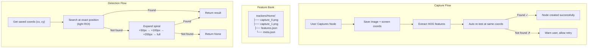

# Detection Engine v3 — Complete Redesign

## Tổng quan

Thiết kế lại hoàn toàn detection engine với 3 trụ cột:
1. **Multi-capture Feature Bank** — mỗi node có nhiều mẫu đặc trưng
2. **Position-first Expanding Search** — tìm tại tọa độ đã lưu → mở rộng dần
3. **Auto-validation** — tự kiểm tra ngay sau khi capture

> [!IMPORTANT]
> Toàn bộ engine KHÔNG sử dụng màu sắc. Chỉ dùng đặc trưng cấu trúc (edge + HOG).

## Kiến trúc mới



## Proposed Changes

---

### Directory Structure: [trackers/](file:///d:/detect-lordnine/tab_nodes.py#328-342)

```
CŨ:  trackers/Home.png + Home.meta.json
MỚI: trackers/Home/
     ├── capture_0.png      ← primary capture
     ├── capture_1.png      ← variant (different background)
     ├── capture_2.png      ← variant (different context)
     ├── features.json      ← HOG descriptors for all captures
     └── meta.json          ← position, detection stats
```

---

### Data Layer

#### [MODIFY] [node_features.py](file:///d:/detect-lordnine/node_features.py)

**Feature Bank storage:**
```python
features.json = {
  "captures": [
    {
      "file": "capture_0.png",
      "hog": [0.12, 0.34, ...],   # HOG descriptor vector
      "screen_x": 200, "screen_y": 393,  # Screen coords at capture
      "frame_w": 1920, "frame_h": 1032
    },
    {
      "file": "capture_1.png",
      "hog": [0.15, 0.31, ...],   # Different background variant
      "screen_x": 200, "screen_y": 393
    }
  ]
}
```

**Key functions:**
- `add_capture(node_dir, image, screen_x, screen_y, frame_w, frame_h)` — adds new capture to feature bank
- `load_feature_bank(node_dir)` — returns list of HOG descriptors
- `match_feature_bank(candidate_hog, bank)` — best cosine similarity against all captures

---

### Detection Engine

#### [MODIFY] [vision.py](file:///d:/detect-lordnine/vision.py)

**Position-first expanding search (cuốn chiếu):**
```python
SEARCH_RADII = [0, 50, 100, 200, -1]  # -1 = full frame

def _detect(frame_bytes, cache_entry, threshold):
    for radius in SEARCH_RADII:
        if radius == -1:
            result = _search_full_frame(...)
        else:
            result = _search_roi(... radius=radius)
        if result:
            return result
    return None
```

**HOG matching against feature bank (multi-capture):**
```python
# Instead of matching ONE template, match against ALL captures
for capture in feature_bank:
    sim = cosine_sim(candidate_hog, capture["hog"])
    if sim >= threshold:
        return True  # matches at least one variant
```

---

### UI: tab_nodes.py

#### [MODIFY] [tab_nodes.py](file:///d:/detect-lordnine/tab_nodes.py)

1. **"+ Add Variant" button** — next to Re-Capture, captures additional feature sample
2. **Capture flow** enhanced:
   - Save screen coords from [on_snip(x1, y1, x2, y2)](file:///d:/detect-lordnine/tab_nodes.py#1024-1031)
   - Extract HOG features immediately
   - Auto re-test: screenshot → detect at captured coords → validate
3. **Feature count indicator** — show [(3 captures)](file:///d:/detect-lordnine/screencapture.py#93-95) next to node name

---

### Migration

On first load: if [trackers/Home.png](file:///d:/detect-lordnine/trackers/Home.png) exists (old format), auto-migrate to `trackers/Home/capture_0.png`.

---

## Verification Plan

### Automated Tests
- Unit test feature bank: add_capture, load, match
- Test expanding search: mock frame with icon at various positions
- Test migration from old format

### Manual Verification
- Capture Home node → verify auto-validation
- Add variant (different bg) → verify both captured
- Run detection → verify expanding search finds icon
